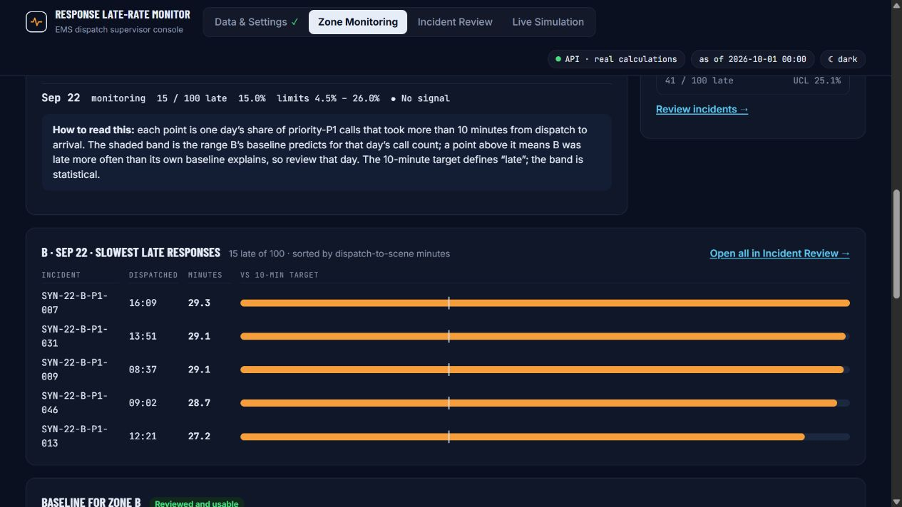
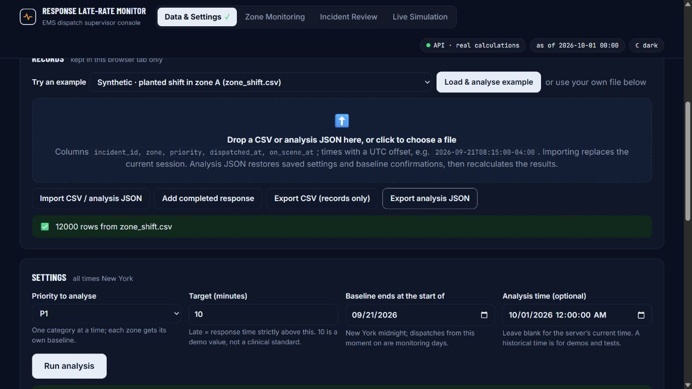
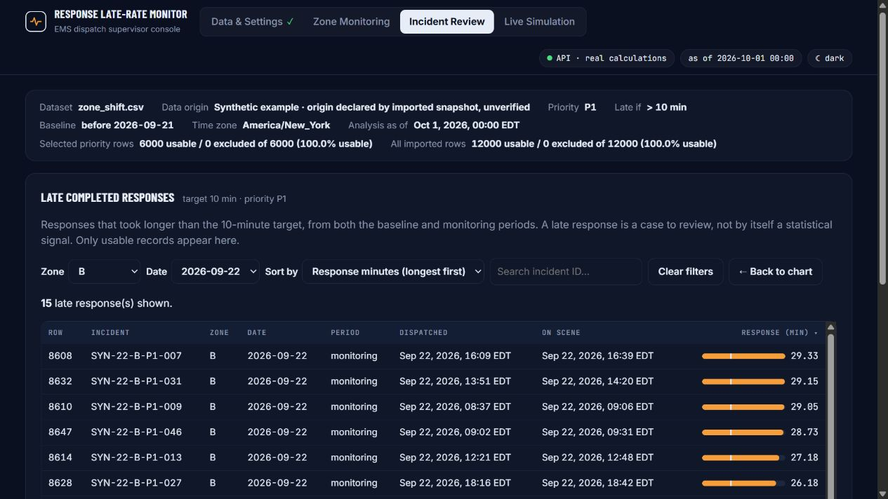
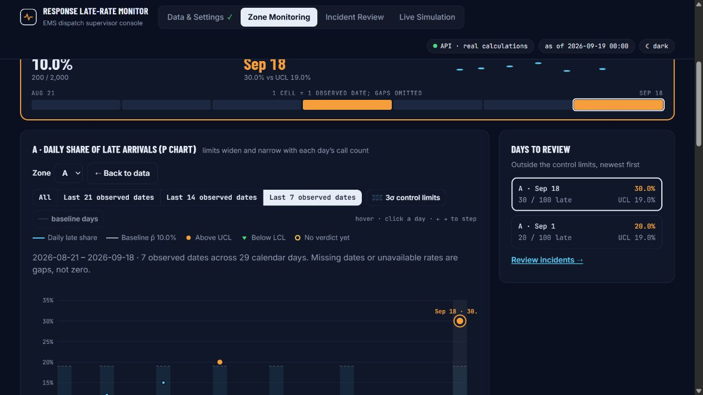

# Stakeholder findings: repair and acceptance

Date: October 17, 2026. Task: H-10. Base commit: `92692246c128827ab45747928bff9bcbba01e098`.

All seven reproducible findings from the five **synthetic** stakeholder reviews have been repaired locally. These reviews are simulated perspectives, not interviews with actual EMS personnel. The existing stylesheet, colors, page layout, statistical core and backend are unchanged. Functional labels, import/export controls, chart date geometry and navigation behavior have changed where required to resolve the findings.

After the completed acceptance report, Shifeng explicitly authorized check-in and push on October 17. H-10 is checked in with this tested change set. Publication uses the existing deployment workflow and existing content target; deployment success is verified separately rather than inferred from a passing local build.

## Findings and observed acceptance

| Finding | Repair | Actual verification |
|---|---|---|
| F1: malformed quotes silently swallowed a row | Strict CSV structure validation before session replacement; quoted multiline cells and extras remain supported. | Original `maya-malformed-quote.csv` rejected with `Unclosed quoted field starting at line 2, column 70.` Previous 12,000 rows, settings and analysis retained. Analysis JSON exported before/after was byte-identical (SHA-256 `2f718691ad7f9d0b7401943386a1a3409c86db913e9af04eaae157f0002fd3da`). All seven repository CSVs still parse and round-trip exactly. |
| F2: switching zone removed the selected incident date | Preserve date and keep it in the options even when the new zone has no matching late cases. | A / September 22 showed 41 late cases. Switching to B kept September 22 and showed **15**, not the previous all-dates count of 457. Unit render verifies the zero-match case retains both zone and date. |
| F3: Back to chart changed the selected day | Parent-owned selection persists across page unmounts; simulation has its own independent selection. | Returning from B / September 22 displayed `B · Sep 22 · slowest late responses`, not a peak-day fallback. JSON export/import also restored this selection. |
| F4: seven observations were labeled seven days and gaps were connected | Explicit observed-date ranges, start/end/calendar span, calendar-scaled x positions and segmented lines/bands. | Known sparse fixture: **7 observed dates across 29 calendar days**, August 21–September 18. Seven separated single-observation segments; no invented zeros. Baseline 200/2,000 = 10%; limits 1%/19%; September 1 at 20% and September 18 at 30% remain the two high signals. Arrow-left selected September 10. With baseline enabled: 27 observed dates across 49 calendar days, eight line segments. |
| F5: synthetic/public origin disappeared after loading | Structured provenance displayed in the shared context and chart footer; distinguish data origin from real API calculations. | Built-in shift: `Synthetic example`; NYC 26,209 rows: `Public historical data`; uploaded sparse CSV: `User upload (origin unverified)`. Imported JSON origin is explicitly declared/unverified. |
| F6: CSV export omitted the settings needed to reproduce an analysis | Keep records-only CSV; add versioned analysis JSON with records/extras, exact analyzed parameters, baseline confirmations, provenance and zone/date. Recompute on import. | Browser snapshot restored target 10, P1, September 21 cutoff, October 1 as_of, A/B review confirmations, **8 signals**, and B / September 22 / 15 cases. Re-export is identical except the required imported-origin flag. A future-as_of snapshot receives HTTP 422 and retains the previous 12,000-row session. Unit tests cover malformed versions, service failures, stale responses, microseconds and both fall-DST 01:30 occurrences. |
| F7: keyboard focus returned to the document body after drilldown | Focus the destination heading; returning focuses the chart's incident action. Exclude hidden simulation content from fallback focus. | Enter on the chart action focused `Late completed responses` (H2). Next Tab reached the Zone selector. Back focused `Open all in Incident Review →`. Keyboard example loading focused the new BROOKLYN chart heading. |

## Regression checks

The installed Node/Python executables were invoked directly using the local dependency environment. Equivalent project commands and actual output:

```text
# From app/frontend
node node_modules/vitest/vitest.mjs run
Test Files  13 passed (13)
     Tests  128 passed (128)
  Duration  1.77s

node node_modules/vite/bin/vite.js build
✓ 56 modules transformed.
✓ built in 5.79s

# From repository root
python -m pytest tests
175 passed, 1 warning in 3.90s

bash .claude/skills/superagent/scripts/check.sh
PASS  check.sh
```

The backend warning is the existing Starlette test-client deprecation of `anyio.abc.BlockingPortal`. There are no failing tests. `git diff --check` passes. The stylesheet, `app/qc.py` and `app/app.py` have no diff.

The executable session-parity check also passed against the local real API (six successful requests):

```text
PASS CSV real_nyc_brooklyn_queens_sev2.csv: 26209 records; exact record and export parity
PASS CSV jingyao_synthetic/stable.csv: 12000 records; exact record and export parity
PASS CSV jingyao_synthetic/zone_shift.csv: 12000 records; exact record and export parity
PASS CSV jingyao_synthetic/edge_cases.csv: 5118 records; exact record and export parity
PASS CSV shifeng_synthetic/stable.csv: 12000 records; exact record and export parity
PASS CSV shifeng_synthetic/zone_shift.csv: 12000 records; exact record and export parity
PASS CSV shifeng_synthetic/edge_cases.csv: 2934 records; exact record and export parity
PASS snapshot target 10: full API response deep-equal; 12000 overall / 6000 P1; 8 signals; B Sep 22 = 15/100 late
PASS target distinction: target 10 = 1091 late; target 12 = 994 late; different saved settings, identical raw CSV; full API response deep-equal after both restores
PASS Maya quality: all 10 rows / 8 columns preserved, including leading zeros, multiline/quoted extras and invalid records; 3 usable / 7 excluded overall; 2 usable / 6 excluded P1; full API response deep-equal
PASS H-10 session parity: 7 repository CSVs; 6 successful real API requests; no cached or mock statistical results
```

Set `STAKEHOLDER_QUALITY_CSV` to `app/frontend/acceptance/stakeholder/maya-quality.csv` when running the parity script to include its optional quality/extra-column check. The API normalizes input timestamps to UTC: timestamp comparison uses equivalent instants, and the **entire original and restored API responses** are compared with deep equality.

Live simulation was also exercised in the browser against the real local API: seed 5300, zone-A-slower scenario, A baseline reviewed, four six-hour steps. It returned **4,200 rows, A 36/100 = 36%, UCL 23.8%, formal high**. Drilldown showed 36 cases and returned to the same day. The separate ordinary NYC session retained 26,209 rows. Browser console contained no errors at the end of acceptance.

## Reproduce the browser checks

Start the real API and frontend with `bash app/testme.sh` in a configured environment. Mock mode must be disabled. Use a separate test browser tab; no production uploads or deployments are required.

1. Load the built-in zone-shift example and confirm both usable baselines. Select A / September 22, open its incidents using Enter, then switch to B and return to the chart. Expect 41 then 15 cases, preserved date and destination focus.
2. Export analysis JSON. Import [the malformed fixture](../app/frontend/acceptance/stakeholder/maya-malformed-quote.csv). Expect an error and unchanged analysis. Export again and compare bytes.
3. Change target to 12 and run. Import the earlier target-10 analysis JSON. Expect restored settings, eight signals, prior selection and an imported-origin notice. Import [the future-time JSON](../app/frontend/acceptance/stakeholder/future-rejected.json); expect HTTP 422 and preservation of the successful session.
4. Import [the sparse fixture](../app/frontend/acceptance/stakeholder/david-sparse-known-truth.csv). Set P1, target 10, cutoff `2026-08-21`, as_of `2026-09-19T00:00` New York. Run and confirm A. Select Last 7 observed dates. Expect seven observations over 29 days, separated rate marks and 1%/19% limits. Test arrow keys and the baseline toggle.
5. Load the built-in NYC example and inspect provenance. Open Live Simulation, load seed 5300, choose Zone A slower, review A and advance four steps. Verify the numbers above, then return to the ordinary analysis and verify its records were retained.

Additional source-to-snapshot/API parity checks are provided in `app/frontend/acceptance/stakeholder/session-parity.mjs`; run with `STAKEHOLDER_API_URL` set to your local API origin. It does not call a production service unless explicitly configured to do so.

## Evidence

Machine-readable observations: [browser-results.json](../app/frontend/acceptance/stakeholder/browser-results.json). Fixtures are deliberately synthetic; the malformed CSV and future JSON are intentional invalid-input tests.








